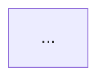

# Plantilla del informe

Usa estos encabezados en este orden. Las secciones que no apliquen se dejan con una línea que explique por qué.

````markdown
# Análisis técnico: <nombre-del-servicio>

> Fecha: <AAAA-MM-DD> · Commit analizado: `<hash>` · Rama: `<rama>` · Profundidad: rápida | completa

## Resumen ejecutivo
<5–8 líneas: qué hace el servicio, estado general y los 3 riesgos principales>

## Ficha técnica
| Campo | Valor |
|---|---|
| Node / NestJS / TypeScript | |
| Gestor de paquetes | |
| Base de datos / ODM | |
| Colas / Cache | |
| Validación | |
| Logging | |
| Tests | <framework> · <n> archivos de test |
| CI/CD | |
| Módulos / Endpoints | <n> / <n> |

## 1. Reconocimiento
## 2. Arquitectura
## 3. Mapa de módulos
| Módulo | Responsabilidad | Depende de | Estado |
|---|---|---|---|

## 4. Endpoints
| Método | Ruta | Guard | DTO / Validación | Handler |
|---|---|---|---|---|

## 5. Lógica de negocio
## 6. Base de datos
## 7. Seguridad
## 8. Errores y observabilidad
## 9. Integraciones
## 10. Tests y calidad
## 11. Infraestructura y despliegue

## 12. Deuda técnica
| # | Prioridad | Área | Hallazgo | Evidencia | Impacto | Recomendación | Esfuerzo |
|---|---|---|---|---|---|---|---|
| 1 | P0 | Seguridad | | `src/...:42` | | | S |

## 13. Diagramas


## 14. Guía de onboarding
1. Requisitos
2. Puesta en marcha
3. Variables de entorno (solo nombres)
4. Tests
5. Dónde está cada cosa
6. Cómo añadir un endpoint

## Limitaciones del análisis
<lo que no se pudo verificar y por qué: no se ejecutaron tests, faltan permisos, código generado...>
````

## Matriz comparativa (modo multi-servicio)

```markdown
| Criterio | mms-a | mms-b | mms-c |
|---|---|---|---|
| NestJS | 10.x | 11.x | 10.x |
| Versioning en controllers | ✅ | ⚠️ parcial | ❌ |
| Guard en todos los endpoints | | | |
| Validación zod | | | |
| Logger de Nest / sin console | | | |
| Exceptions propias | | | |
| Tests (archivos) | | | |
| CI con tests antes del deploy | | | |
| P0 / P1 abiertos | | | |
```

Leyenda: ✅ cumple · ⚠️ parcial (con evidencia) · ❌ no cumple · ❔ no verificado.
